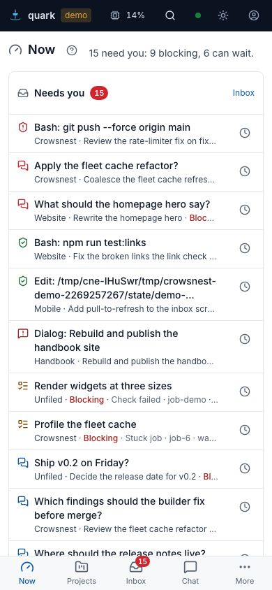

# The attention queue and Now

Everything that will not move until you act is one list: the **attention queue**. crowsnest builds
it once, on the server, and every place in the app shows the same list and the same number: the
badge on Inbox, the tab title, the tray, the palette's **Needs you** group, Now and the Inbox.

## What goes in it

- **Approvals**: a tool call waiting for **Allow once** or **Deny**.
- **Questions** (not notices): what an agent asked you.
- **Terminal dialogs**: an agent stopped at a menu on its screen.
- **Jobs** that need you and are not already listed through one of the above: stuck, a failed
  check or review, a budget reached, held for your approval to start, failed in the last 72 hours,
  or finished in a worktree and ready to land.
- **Standing agents** (the orchestrator or a lead) that need their terminal or have failed.

**One item per obligation.** An approval and the dialog on the same pane are one item. A job is
listed through whatever stands for it (its question, its approval, its dialog), and by itself only
when nothing else does.

Each item says where it belongs: its project (or **Unfiled**), its job, its agent, how long it has
waited, and what resolves it.

## Order: blocking first

Every item carries one of four labels, in this order:

- **Dangerous**: a dangerous approval (a force push to `main`, say). Work has stopped and no rule
  may ever allow it. Counted as blocking.
- **Blocking**: work has stopped on it and no [approval rule](questions-approvals-dialogs.md#approvals) could have
  answered it: a question its job stopped on, a terminal dialog, a job only you can fix, a
  standing agent in trouble, an elevated call, or a command no rule can match.
- **Approval**: a routine, low-risk call a rule could have allowed (`npm run test:links`). The
  agent waits on it, but a project rule would save you the tap next time.
- **Can wait**: work carries on meanwhile: an ordinary question, a job retrying a usage limit by
  itself, a failure to look at, a worktree ready to land.

Within a label, dangerous approvals come first, then the longest wait. The count line reads, for
example, "15 need you: 5 blocking, 3 approvals, 7 can wait". A notification on your lock screen
says "blocking question" by the same rule.

## Snooze and dismiss

- **Snooze for 10 minutes** hides an item from the count on every device (the Inbox lists snoozed
  items folded, with **Bring back**). It decides nothing.
- Only a **failed job** can be dismissed. Everything else leaves the queue when what it stands for
  is resolved: answered, allowed, landed, unstuck.

## Now

Now is home ([Open Now](app:/), `g` then `h`). Top to bottom on a phone; side by side from a wide
screen:

1. **Needs you**: the queue. Each row expands in place: an approval's card with **Allow once** and
   **Deny**, a question's options, a dialog's buttons, a job's way in. On a phone, the top three
   and **Review all N**, which opens the Inbox with the rest.
2. **Projects**: one row per project with its lead's state, what it is doing in a line, running /
   waiting on you / done today, estimated spend today, last activity, and one sentence saying who
   owns its work (that sentence is left out on a phone). Then **Unfiled** (jobs in no project) and the **Orchestrator**. A row opens the
   project, the unfiled board, or Chat.
3. **Since you left**: jobs that finished, failed or were cancelled, and questions asked, since this
   browser was last here (a gap of ten minutes starts a new window; a browser never seen gets the
   last twelve hours). **Mark all seen** clears it. A phone shows the latest five and **Show all**.
4. **Give a job**: the job box, with **For** choosing the orchestrator or a project.

## The tray

On every view except Now and the Inbox, the tray shows the queue: a column docked at the right
of a desktop (beside the view, never over it; **Fold the tray** shrinks it to a strip), a bar
above the bottom nav on a phone. `g` then `n` focuses it; with an approval open,
`y` or `n` answers it. A routine question's options can be answered right there; anything else
offers **Review the decision**, which opens the full decision screen.

## The Inbox

The Inbox ([Open the Inbox](app:/inbox), `g` then `i`) is the queue in full, with **History** for
what was answered, and **Notices** kept apart. On a desktop the list and the selected item sit side
by side; on a phone each item opens as a [decision packet](../how-to/answer.md#the-decision-packet).

## What can go wrong

- **The count is higher than you expect.** Snoozed items are not counted; failed jobs stay for 72
  hours unless you dismiss them; a ready-to-land worktree stays until you land or discard it.
- **Something is missing.** When herdr cannot be read, dialogs cannot be seen either; the header's
  connection state and **System** say whether herdr is connected.
