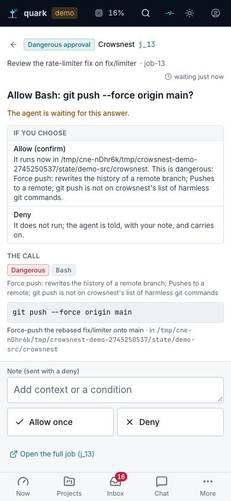

# Answer questions and approvals

Everything that needs you is one [queue](../concepts/attention-and-now.md), and you can answer from
wherever you are. What the three kinds are: [Questions, approvals and terminal
dialogs](../concepts/questions-approvals-dialogs.md).

## From Now or the tray

1. On **Now**, press an item under **Needs you** (anywhere else, the tray at the bottom shows the
   count; `g` then `n` focuses it).
2. It expands in place:
   - an **approval** shows the call (the command and its directory, or the edit as a diff) with
     **Allow once** and **Deny**;
   - a **routine question** (one choice, short, with a recommendation) shows its options, the
     recommended one marked: press one;
   - anything else offers **Review the decision**, which opens the decision packet (below); a
     routine question offers **Review (add a note)** beside its options.
3. With the tray focused on an approval, `y` allows and `n` denies.

Several low-risk calls waiting from the same agent show **Allow N low-risk calls from <agent>**.

## The decision packet

On a phone every question, approval and dialog opens as one screen, top to bottom:

1. **Where it belongs**: the kind, the project, the job (a link), the agent, how long it has waited.
2. **The ask** in a line, and what stays blocked ("The agent is waiting for this answer").
3. **If you choose**: each choice with what it does ("It runs now in <dir>", "It does not run; the
   agent is told, with your note, and carries on", "Presses 2 in the agent's terminal").
4. **The recommendation**, when the agent made one.
5. **The evidence**: what the agent wrote, the change (a file list first; long diffs folded), the
   call, the screen, and the agent's last message.
6. **The answer bar**, at the bottom under your thumb: the note, the choices, and **Open the full
   job**.

Your **note** survives rotating the phone, switching apps, or iOS throwing the page away; it is
cleared once the answer is in. If someone answered elsewhere, or the dialog went away, the packet
says so instead of offering buttons. After an answer it moves on to the next decision, or back to
Now.

## Answering a question

- **Choice** or **confirm**: press the option. Several allowed? Tick them and **Submit**.
- **Manual**: write in **Your answer**, then **Send answer**.
- Add a **note** for context or a condition. The agent receives `[crowsnest answer q_7] <title> →
  <answer> (note: …)`.
- A **gate** (a land request, a job outside its directory, anything that allows, approves, merges,
  pushes, deploys, deletes, grants or permits) asks "This widens what agents may do… Yes, <label>" before it answers.

Then watch the [receipt](../concepts/questions-approvals-dialogs.md#receipts): **Received** means
the agent took it in.

## Answering an approval

- **Allow once**: runs that one call. A **dangerous** call asks again ("Yes, allow"), and the
  server checks it.
- **Deny**: with a note (**Note (sent with a deny)**) telling the agent what to do instead.
- **Allow and remember for this job**: allows it and calls like it for the rest of this job (an
  elevated call is remembered only as exactly itself; one crowsnest does not recognise, not at all).
- A standing rule for the project: [approval rules](projects.md#approval-rules).

The same call is also on the agent's terminal as Claude's dialog; answering either is fine.

## Answering a terminal dialog

Press the option's button; crowsnest presses that key in the pane, bound to the screen it read. If
the screen changed in between, nothing is pressed and the card refreshes. A form (several fields)
offers its terminal instead.

## From the Inbox

[Open the Inbox](app:/inbox) (`g` then `i`): **Open** is the queue, **History** what was answered,
and **Notices** apart. On a desktop the list and the selected item sit side by side; on a phone
each item opens as a decision packet. A snoozed item is folded, with **Bring back**.

## From the lock screen

A notification says where it belongs and what is asked: "quark: Website: blocking question",
"j_15 Homepage hero: Which hero copy? · Recommended: Short headline". Tapping it opens the decision
packet. Buttons appear only where the phone shows them (never on iOS), and only for safe cases:

| Item | Buttons |
|---|---|
| Low-risk approval whose command fits uncut | Allow, Deny |
| Low-risk approval whose command was cut | Snooze |
| Elevated or dangerous approval | none |
| A gate (land, allow, approve, merge, push, deploy, delete, grant, permit) | none |
| Routine question with a recommendation | the recommended option, Snooze |
| Any other question, a dialog | Snooze |

**Snooze** hides the item for ten minutes on every device and decides nothing. More:
[Notifications](../reference/notifications.md).

## From the palette

`⌘K`, and the **Needs you** group lists the queue. For a confirm or single-choice question, `→`
shows one **Answer: <label>** per option, the recommended one marked.

## What can go wrong

- **"Already answered"**: someone (or the terminal) answered first; the packet says so.
- **The answer is Held**: the agent is at a dialog or has text in its input box. Clear that; it is
  delivered.
- **An approval expired**: after 12 hours Claude's own dialog is still on the agent's terminal;
  answer it there or in the Inbox's dialog item.
