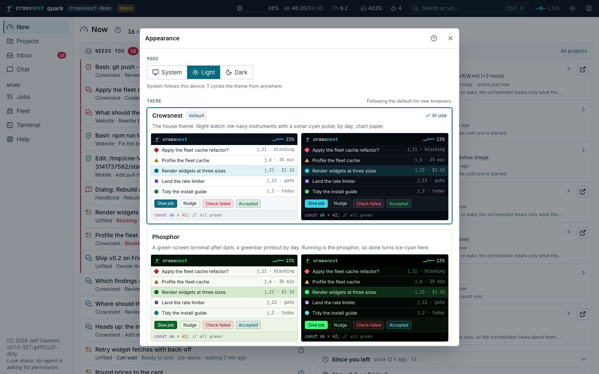

# Choose a theme

crowsnest has five themes, each a matched pair of a light and a dark version, and a separate
**mode** that chooses between light and dark. The two are independent: pick the theme you like,
and the mode follows your device or stays fixed.

## The themes

| Theme | What it looks like |
|---|---|
| **Crowsnest** | The house theme: ink-navy at night with a sonar-cyan accent, chart paper by day. |
| **Phosphor** | Green phosphor on black, a greenbar printout by day; the whole interface in a monospace face. |
| **Deep sea** | Abyssal indigo with a bioluminescent periwinkle, sea ice by day. |
| **Ember** | Warm charcoal and forge orange, parchment by day. |
| **High contrast** | Black and white with signal colours; every text colour at WCAG AAA (7:1) on every background. |

Whatever the theme, the header stays dark, and the job states keep their meaning and their
shape: needs you is a diamond, stuck a triangle, running a pulsing dot, done a filled dot, held a
square. Only the hues change between themes, so you can read a board by shape alone.

Themes cover everything: the terminals' colours, code and diff highlighting (the diff viewer's
added and removed lines included), charts and diagrams.

## Choose one

1. Account menu → **Appearance** ([Open Appearance](app:sheet/appearance)), or the **Appearance**
   link in the Settings sheet, or the palette.
2. **Mode**: **System** (follows this device's light or dark setting), **Light** or **Dark**.
3. **Theme**: the gallery shows every theme in both modes, drawn with real parts of the app. Press
   one to use it.

From anywhere outside a text field or a terminal, `T` switches to the next theme. In the palette,
**Theme: <name>**, **Next theme** and **Mode: System**, **Mode: Light** or **Mode: Dark** do the
same. The header's sun/moon button cycles the mode.

The choice belongs to **this browser** (it is kept in the browser's storage), so your phone and
your laptop can differ. It is applied before the page draws, so nothing flashes on load.

## A default for new browsers

A browser that never chose follows the instance's default. In Appearance, **Use for new browsers**
under a theme makes it that default (the `theme` setting; also `--theme` or `CROWSNEST_THEME`). A
browser that chose its own theme says "Chosen in this browser." and has **Follow the default** to
go back.

## What can go wrong

- **The theme changed by itself**: you pressed `T` outside a text field. Press it again to cycle on,
  or pick in Appearance.
- **Another device still shows the old theme**: themes are per browser. Choose there too, or set
  the default for new browsers.
- **Hard to read in sunlight**: try **High contrast**, in Light mode.
