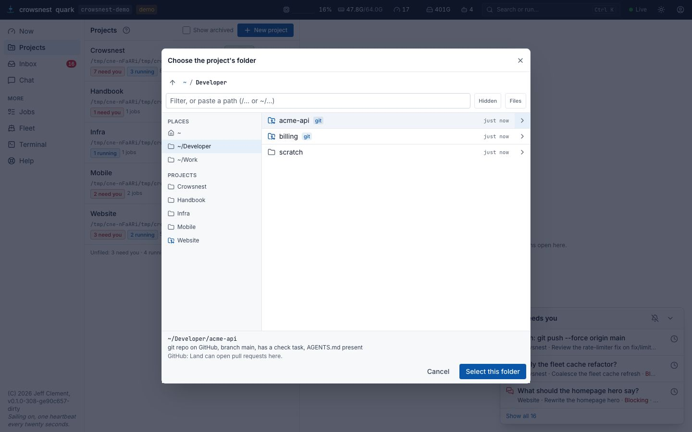
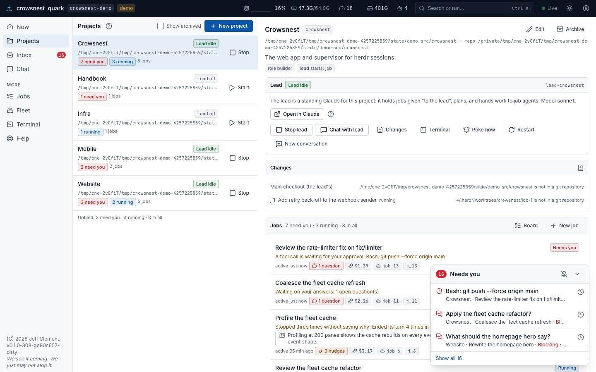

# Create a project and tune its lead

A project gives a repository its own standing lead, its own instructions, defaults for its jobs,
a check command, budgets and approval rules. Concepts: [Projects, leads and the
orchestrator](../concepts/projects-and-leads.md).

## Create one

1. Open **Projects** ([Open Projects](app:/projects)) and press **New project**.
2. **Directory (where its jobs run)**: the repository's main checkout. Press **Browse…** to pick
   it ([Choosing the folder](#choosing-the-folder), below), or type a path (`~` works), or pick
   one of the **Remembered directories** (places you have given jobs before).
3. Once the directory is known, crowsnest reads it and fills in what it can: the **Name** (from the
   folder's name, until you type over it) and the **Check command (how crowsnest checks a job's
   finished work)** (`mise run check` when the repository has a mise `check` task). It also says
   what Land can do with the repository's remote, for example "GitHub: Land can open pull
   requests here." or "Azure DevOps: Land will not open pull requests here; it merges locally."
4. **Short name** (optional) is used in links and in the lead's name, `lead-<short name>`; it never
   changes afterwards. **Description**: what it is, in a line. The lead reads it.
5. Open **Defaults for its jobs and lead** if you want to change them (below).
6. Press **Create project**. A check command you changed from the detected one is saved with it.

The palette's **New project in…** opens New project with the folder picker already up.

## Choosing the folder

**Browse…** opens **Choose the project's folder**:

1. **Places** (on the left; chips on a phone): your home, `~/Developer` and `~/Work` when they
   exist, your projects and their parents, the directories you gave jobs in, and this browser's
   **Recent** choices.
2. The list shows the current folder's folders first. Git repositories are marked **git** and come
   first. Click a folder to highlight it; double-click it, press its chevron, or press Enter or →
   to open it. **Up one folder** (or Backspace in an empty box, or ←) goes back.
3. The box at the top (**Filter, or paste a path (/… or ~/…)**) filters the list as you type, or
   jumps to a path you paste. **Hidden** and **Files** show hidden entries and files (files are
   greyed: for orientation only, never opened).
4. The bar at the bottom, always in view, shows the highlighted folder's facts in a line (git repo,
   its host and branch, a check task, `AGENTS.md` or `CLAUDE.md`), what Land can do with its
   remote, and warnings: not a git repository (jobs there cannot get worktrees), inside a
   repository but not its top folder, inside or around an existing project, your home folder (too
   wide).
5. **Select this folder** (`⌘ Enter`, `Ctrl Enter` elsewhere), or **Cancel**. Escape closes the
   picker alone and leaves the form as it was.

The job box's **Where** has the same picker (the **Browse…** button, "Browse for a folder"); there
a folder inside a project is information, not a refusal.

**What it can see.** The picker only lists folders under your home directory, the directories
your projects and remembered jobs use, and any `--browse-root` you add (`/` only if you name it).
A link that leads outside those is marked **outside** and not followed; a folder you cannot read
is marked **no access**. It only reads: it never creates, renames or deletes anything, and never
opens a file. A slow or dead network mount answers within a few seconds rather than hanging.

## Defaults for its jobs and lead

On **New project**, or **Edit** on the project's page:

| Field | What it sets |
|---|---|
| **Role** | The role a job in this project gets when you do not choose one. |
| **Engine** | Claude or Codex for its jobs. Choosing Codex shows a note of what it does not get: crowsnest supervises Claude through its hooks, and Codex has none. |
| **Model** | The model for its job agents (empty: crowsnest's default). |
| **Own worktree** | **Yes, a worktree per job**, or **No, work in the directory**. |
| **Permission mode** | The lead's Claude Code permission mode. |
| **Start the lead** | **Only when I start it**, **When I open the project (or give it a job)**, or **When the project is given a job for its lead**. |

## The project page

Open a project from **Projects** or a row on **Now**. Top to bottom:

- **Edit** and **Archive** (archived projects take no jobs; their lead stops; **Show archived** on
  the list brings them back into view).
- **The lead**: its state, then **Start lead** / **Stop lead**, **Chat with lead**, **Terminal**
  (its pane in Agents), **Poke now**, **Restart** (same conversation), **New conversation**, and
  **Open in Claude** when its Remote Control link is known.
- **Jobs**: the project's jobs, with **Board** (the Jobs board filtered to it) and **New job**.
- **Schedules**: its scheduled tasks with **Run now**, and **Manage** (the Schedule sheet).
- **Approval rules** (below).
- **Acceptance and budget**: the check command and per-job budgets (below).
- **Project instructions**: the project's instruction layer, edited in place.
- **Instructions**: what its lead started with, with **Restart with new instructions** when that
  changed.

## Tune the lead

- **What it should know**: write the project's instructions (its gate command, where things live,
  what not to touch) in **Project instructions** and **Save**. The lead and every job agent in the
  project get it. A running lead restarts by itself on the same conversation to
  pick it up at its next idle moment; **Restart with new instructions** on its Instructions card
  does it now. See [Instruction layers](../concepts/instruction-layers.md).
- **Its model**: leads run on the orchestrator's model (Settings → Agents → **Orchestrator
  model**). The job agents use the project's **Model** default.
- **Its voice** (with talk mode on): account menu → **Settings** → **Voice**, where each standing agent has its
  own voice and Speak switch, so you can tell two leads apart by ear. See [Talk and listen](voice.md).
- **When it runs**: **Start the lead** (above). **Stop lead** keeps it stopped until you start it.

## The check command

On the **Acceptance and budget** card, **Check command**:

- leave it **empty** for automatic: `mise run check` when the repository's mise config has a
  `check` task, else nothing;
- type a command (`make test`, `go test ./...`) to run that, with `sh -c`, in each job's worktree;
- type `none` for no check (jobs finish **Unverified**).

The card says what runs now. Press **Save**. What it means: [Acceptance](../concepts/acceptance.md).

**Budget per job ($)** and **Budget per job (minutes)** on the same card bound each job in the
project ([Budgets](../concepts/budgets-limits-pause.md#budgets)).

## Approval rules

So your phone is not a tap per test run, crowsnest keeps approval rules of its own, per project.
A call a rule matches is allowed at once by the hook, without asking you, and journalled on the
job's timeline. Rules live in crowsnest, not in the agents' settings.

1. On the project page, in **Approval rules**, choose the **Kind**: **Bash command**, **File
   edits**, or **Tool**.
2. **Pattern**: a whole command with `*` for anything (`go test *`), a path (`internal/`), or a
   tool name (`WebSearch`). Every part of a `&&` or `|` chain must match a rule.
3. **Also when elevated**: off by default. Elevated calls push, install, reach the network or
   write outside the job; turn it on only for a pattern you trust that far.
4. **Note (optional)**: why this is safe.
5. Before saving, the card shows what the rule would have matched recently. **Add rule**.

A **dangerous** call is never allowed by a rule. **Remove** deletes one. On an approval card,
**Allow and remember for this job** makes a narrower rule that ends with the job.

## What can go wrong

- **"overlaps project …"**: one live project's directory may not contain another's. The picker
  warns about this before you choose.
- **The folder you want is not in the picker**: it is outside your home and every project. Start
  crowsnest with `--browse-root <dir>`, or type the path.
- **The lead does not start**: its folder may be waiting at Claude's trust question; open
  **Terminal** and answer it.
- **Jobs do not join the project**: a job joins only if its directory is inside the project's.
  Give it **For** the project in the job box.
