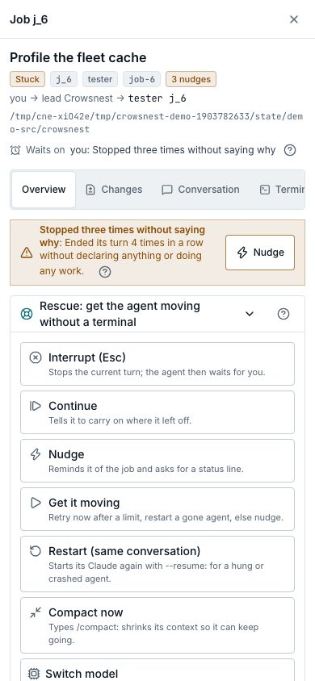

# Rescue a stuck agent

Most stuck agents can be got moving without a terminal, from a phone. First read why it is stuck:
the card names the cause, and [the supervisor's table](../concepts/supervisor.md#stuck-causes)
says what each one needs. The decision tree is [The agent stopped: what
now?](../troubleshooting/agent-stopped.md).

## The one action

A stuck job's Overview opens with the cause and **the one action that fits it**:

| Action | For |
|---|---|
| **Nudge** | It stopped without declaring anything, or keeps being denied. |
| **Retry now** | A usage or rate limit, or API errors (it would retry by itself; this does it now). |
| **Restart agent** | The agent exited. |
| **Open terminal** | A dialog, a login, a refused model, silent while working, spinning, or a failed launch. |
| **Answer in Inbox** | It is waiting on a question or an approval. |
| **Start anyway** | It is held waiting for a slot, the load, the pause or the usage limit. |
| **Run the check again** | crowsnest's check failed. |
| **Open the review** | The reviewer still objects. |
| **Decide on the budget** | It reached its budget. |

When the agent said something, its words come next ("I'm not sure how to proceed without changing
herdr's event shape"), with the message box right under them: often a sentence from you is the
fix. Then the action is **Reply** rather than another nudge: after two nudges, or when its last
message asks a question ("It asked something in its message"), the banner's button puts you in
the message box.

## The Rescue panel

Below it, **Rescue: get the agent moving without a terminal** (open by default when the job is
stuck or needs you; folded as **Other ways to get it moving** when the agent's words and the
message box come first), each button saying what it does:

1. **Interrupt (Esc)**: stops the current turn; the agent then waits for you.
2. **Continue**: tells it to carry on where it left off (or say why it cannot, with job_update).
3. **Nudge**: reminds it of the job and asks for a status line.
4. **Get it moving**: retry now after a limit, restart a gone agent, else nudge.
5. **Restart (same conversation)**: starts its Claude again with `--resume`, for a hung or crashed
   agent. Asks first.
6. **Compact now**: types `/compact` to shrink its context so it can keep going. Only while it is
   idle.
7. **Switch model**: `sonnet`, `opus` or `haiku` for the rest of this conversation (a restart goes
   back to the job's model). Only while idle.
8. **Open the terminal**: for anything else, the agent's own pane.

When a dialog is on its screen, the dialog's own options are offered too. **The last screen, as
text** shows what the pane looks like without opening a terminal.

To say something in a sentence, use the message box under it (**Message to job-N**, **Send**).

The panel is not offered on a job the orchestrator or a lead holds in its own conversation: use
Chat with that agent instead.

## A typical rescue

1. The card says **Stuck: Stopped three times without saying why**. Open it.
2. Read **What the agent last said**: "Profiling shows the cache rebuilds on every event. I'm not
   sure how to proceed without changing herdr's event shape."
3. It is not broken, it needs a decision. In **Message to job-6** write: "Do not change herdr. Debounce
   the rebuild to 150 ms in internal/fleet and measure again." **Send**.
4. The job goes back to **Running**. The nudge budget resets with the new progress.

If it really is wedged (no reaction, the screen frozen): **Interrupt (Esc)**, then **Continue**; if
that fails, **Restart (same conversation)**.

[Open Jobs](app:/jobs) to find stuck jobs: they are at the top, under **Needs you or stuck**.

## What can go wrong

- **Compact now and Switch model are greyed out**: they only work while the agent is idle; a slash
  command typed mid-turn would arrive as text. Interrupt first.
- **Restart keeps failing**: after three restarts in an hour the job fails. Open the terminal and
  look at what Claude prints at start (a login, a trust question, a bad model).
- **A nudge does nothing**: the agent is at a dialog (answer it) or has a draft in its input box
  (open the terminal and clear it).
