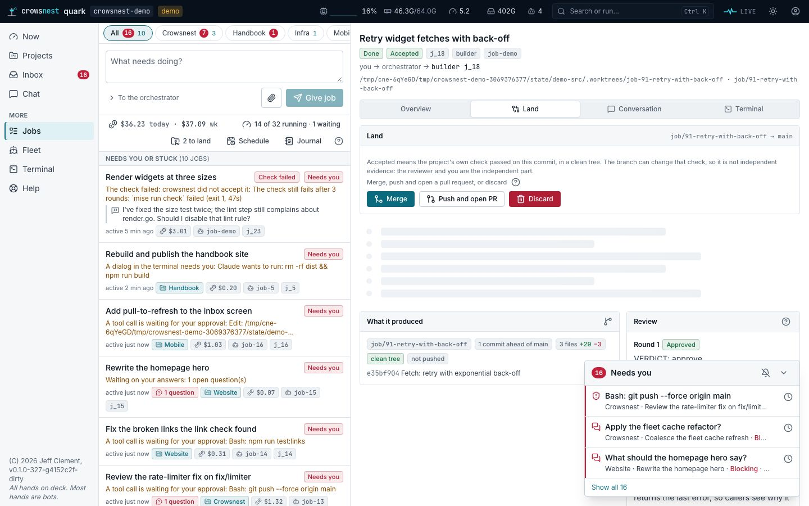

# Review and land a job

When a builder finishes in its worktree, its branch is still there. Landing (merge, pull request
or discard) is always your step. Concepts: [Worktrees and landing](../concepts/worktrees-and-landing.md)
and [Acceptance](../concepts/acceptance.md).

## When it is ready

A finished worktree job is **Ready to land** in your queue (can wait), the board's **N to land**
button counts it, and its Overview says, for example, "Finished in its worktree, review approved:
merge it, open a pull request, or discard it" with **Review and land**.

Before you look at the diff, check two things in the Overview (the card's one chip says **Ready to
land** when both are fine):

- crowsnest's check, beside the state: **Accepted** (crowsnest's check passed at this commit), **Unverified** (no
  check command), or a problem (**Check failed**, **Evidence stale**, **Needs rebase**);
- the result's **Not verified (reported by the agent)**: what the agent says it did not test.

## Review it

1. Open the job and press **Review and land**, or the **Land** tab (it is called **Review** while
   the job is not landable yet).
2. **What it produced**: the branch and base ("job/91-retry-with-back-off → main"), commits ahead,
   files and lines changed, whether the tree is clean and whether it is pushed; then the
   **Commits**.
3. **The changes**, in the [diff viewer](review-changes.md): every changed file, highlighted, with
   a **Viewed** box each. Read them and tick them off; **Full screen (f)** gives the diff the whole
   window.
4. Beside it, **The agent's account**: the **Review** rounds (each reviewer's verdict and
   findings), the **Walkthrough** (chunk by chunk: why each exists, what was tested, the risk), and
   the **Result** with Verified and Not verified.

The diff is the [diff viewer](review-changes.md): syntax-highlighted, split or unified, live as
the agent works, with a **Viewed** box per file. Tick files as you read them; the Land
confirmation then says how many of the files it would merge you have not viewed.

## Land it

1. Under **Land**, press one:
   - **Merge**: into the base, in your main checkout, as a merge commit (or fast-forward only with
     the **Land merges with** setting);
   - **Push and open PR**: push the branch; on GitHub with `gh` signed in, open a pull request with
     the walkthrough as its body;
   - **Discard**: throw the branch away.
2. Read the confirmation. It names the commit you reviewed and says exactly what will happen:
   "Commit 9eb9effd67, as reviewed: Merge job/91-retry-with-back-off into main with a merge
   commit, in the main checkout …". If the branch has moved past that commit, nothing is landed.
3. **Yes, merge** (or the action's own words), or **Not now**.
4. crowsnest merges (or pushes), then tears down: stops the agent, removes the worktree, closes the
   workspace, deletes the branch (kept for a pull request). Each step lands on the timeline.

## When not to push or merge

- **The check failed, is missing, or is stale.** Land refuses, and says why. Fix it first: **Run
  the check again**, or message the agent. You *can* override with the ticked box in the
  confirmation; it is journalled as "Landed over crowsnest's evidence". Do that only when you have
  checked yourself.
- **Needs rebase.** The base moved on. **Ask an agent to rebase** starts a job that merges the base
  in, resolves conflicts, runs the check and commits; then land.
- **The base branch is protected** (`--protected-branch`): Merge is refused; use **Push and open
  PR**. crowsnest never pushes onto a protected branch.
- **On a shared remote**, prefer **Push and open PR** so others can review.
- **Not verified says something important** ("did not run against the real service"): check it
  yourself, or send it back with a message.

## Sending it back

To point at code, comment in the diff on the Review tab: select a line number (or a range), press
`c`, write what to change; then **Send N comments to the agent** sends them all as one message, with
the quoted code ([Review changes: Comments](review-changes.md#comments)). For a job that is already
done, that starts a fix job in its worktree, and the job is checked again when it finishes.

For anything else, write in the job's message box (**Message to job-N**) what to change and
**Send**. The agent picks it up on its next turn; when it says done again, it is checked again.
After a failed final review the agent's done is refused until you land, discard, or send it back.

## Clearing old worktrees

The board's **N to land** (or **Worktrees to land** in the palette) opens **Worktrees still
around**: choose jobs, **Discard chosen**. A worktree with uncommitted work is refused, never
forced.

[Open Jobs](app:/jobs) to find what is ready.

## What can go wrong

- **"the main checkout has uncommitted changes"** or is on another branch: that is your working
  copy; crowsnest will not touch it. Commit or stash, switch back, land again.
- **A conflict**: the merge is aborted and the files named. **Ask an agent to rebase**.
- **"Landed, not torn down"**: a teardown step failed (often uncommitted files in the worktree).
  Fix it and press **Tear down again**.
- **The pull request was not opened**: the remote is not on GitHub, or `gh` is not signed in. The
  branch was pushed; open the request on your host.
