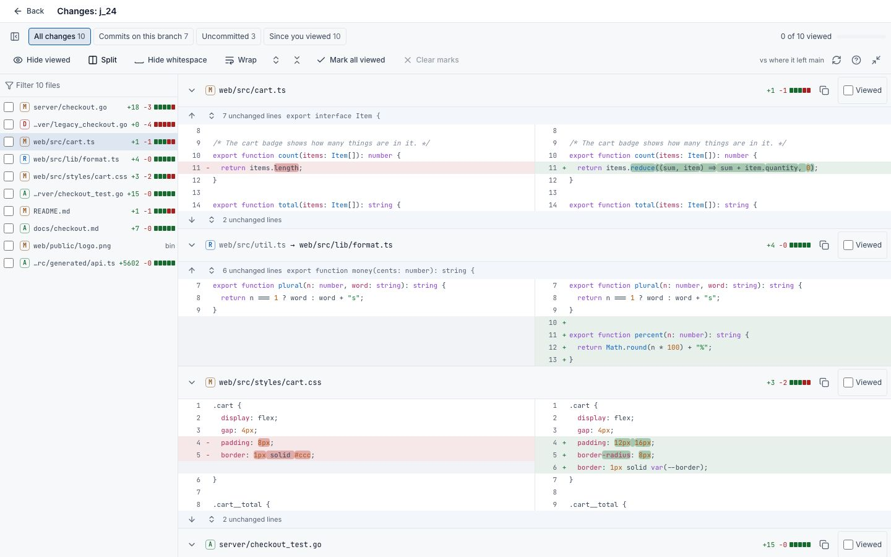

# Review changes with the diff viewer

The diff viewer shows what an agent changed, live, with syntax highlighting, and remembers which
files you have already looked at. Use it while a job is still running ("what is it doing to my
code?"), before you land a job, or to see a lead's uncommitted edits in a project's main checkout.

## Where to open it

- **A worktree job**: its **Review** tab (called **Land** once it is ready to land).
- **A job working in a directory** (no worktree of its own): its **Changes** tab.
- **A project**: the **Changes** card on its page lists the main checkout and every job checkout
  with changes, each with its line counts and how much of it you have viewed; the lead's controls
  have a **Changes** button, and Chat with a lead has a Changes link in its header.
- **The palette**: type `changes` and a job or project name for **Changes: <job>** or **Changes:
  <project>**.
- **Full screen**: **Full screen (f)** in the viewer, or **Open in a new tab**. It is its own page,
  `/diff?job=j_24` or `/diff?project=<slug>`, with nothing of the app around it; **Back** or Esc
  returns to where you were, keeping the file and the scroll position.

[Open Jobs](app:/jobs) and pick a running job to try it.

## Reading it

1. **Which changes** (the buttons at the top, each with its file count):
   - **All changes**: everything since the branch left its base, committed or not;
   - **Commits on this branch**: only what is committed (what Land would merge);
   - **Uncommitted**: what the agent has not committed yet;
   - **Since you viewed**: only what changed in files since you last marked them viewed.
2. **The file list** on the left (a sheet on a phone): each file with its status (added, modified,
   deleted, renamed, binary), its line counts and a **Viewed** box. **Filter** narrows it by path.
   The panel button beside the scopes hides or shows it.
3. **The diff**: syntax-highlighted, with line numbers on both sides and the changed words
   emphasised. **Split** shows old and new side by side on a wide screen; press it again for one
   column. **Hide whitespace** and **Wrap** do what they say. The arrows in a gap ("7 unchanged
   lines") show 20 more lines up or down, or the whole gap. Generated files, lockfiles, images and
   very large files start folded, saying why.
4. The viewer is **live**: as the agent edits and commits, the list and the diff follow within
   seconds, without reloading the page. **Refresh** reads it again now.

## Viewed marks

Tick **Viewed** on a file when you have read it. The file folds away, and the count at the top
("3 of 10 viewed") goes up. **Hide viewed** leaves only what you have not read; **Mark all
viewed** and **Clear marks** do it for every file.

A mark belongs to the file's **content**, not its name. If the agent changes a file after you
marked it, the file comes back, flagged **changed since you viewed it**, and **Show since viewed**
shows only the new edits, not the whole file again. A mark made in one scope counts in the others
when it is the same change. Marks go away when the job lands, is discarded or is deleted.

On the Review tab, the Land card and its confirmation say how many of the committed files (what a
merge takes) you have **not viewed** ("2 of 7 committed files not viewed"); the viewer's own count
covers uncommitted work too. On a phone, ticking **Viewed** moves on to the next file not viewed. To make that a rule, turn on **Require all files viewed before
Land** in Settings ([Open Settings](app:sheet/settings)); Land then refuses until every committed
file is viewed.

## Comments

Point at the code you want changed instead of describing where it is.

1. **Select lines**: click a line number (the old side's on a removed line, the new side's on an
   added one). **Shift-click** another number, or **drag** down the numbers, for a range. On a
   phone, tap a number, then tap another to extend. A bar at the bottom of the window (on a phone,
   just above Previous and Next) says what is selected.
2. **Comment**: press `c`, tap the selected line again, or press **Comment** in that bar; write what should change, **Save comment**
   (Ctrl or ⌘ Enter). Every change block also has **Ask for change here** above it (its lines),
   and every file has one in its header (the whole file).
3. The note is a **draft**, kept on the server: it survives a reload and shows on your phone too.
   It sits under the last line it covers, with a dot by each line number it covers. Edit or delete
   it until you send it.
4. **Send**: the **N to send** button in the viewer's header (a count on a phone) opens the
   Comments sheet: every note by file, an optional **overall note**, **Preview the message**
   (exactly what the agent will get), and **Send N comments to the agent**. All of them go as
   **one message**: each note with its file, its lines, the quoted code and what you wrote. A long
   one goes as an attached file. The job's **Review** tab counts the notes waiting
   ("Review · 2") and has the same Send under the diff, with when they were last
   sent.

What sending does depends on the job:

- **Running, or waiting on something**: the message goes to its agent at once (queued behind the
  turn it is in). A job whose final review still objects goes back to work, as a message would.
- **Paused, or held** (a budget, a failed check, a question it asked): the message waits and is
  typed when nothing holds the job any more, a job waiting on a timer or on you included. Its notes
  show **waiting to be typed** until then, not sent. crowsnest never starts a turn a hold forbids,
  and never types them over a draft someone left in the agent's input box: if one is there, they
  wait, and **Let them type over a draft** under the notes lets them.
- **Finished** (done or accepted): a finished job is not reopened. Sending starts a **fix job** in
  its worktree with your comments as its brief; when the fix job is done, crowsnest checks the job
  again, as after a rebase. The job does not land until you accept the changes
  ([Review and land: Sending it back](review-and-land.md#sending-it-back)).
- **Being checked or reviewed by crowsnest**: refused until that ends.
- **A project's changes**: the comments go to its lead (start it first), or to the orchestrator for
  its folder.

After sending, a note shows **sent**; a note you edit after sending goes with the next send again.
A note marked **may not have arrived** was in a send crowsnest lost track of (it stopped while
typing): send it again if the agent did not get it. When the agent changes the file, notes on it
show **outdated**, under the file's header, with the code they were about; a note on the removed
side goes outdated when the branch's base changes under it. **Dismiss** one that has been
dealt with, or **Re-send** it with the next send. Notes go when the job lands or is discarded. With
**Require all files viewed before Land** on, Land's confirmation names any notes you have not sent
(a warning; it does not stop Land).

Code the agent wrote can hide characters that read differently from what they do: a quote or a
note holding one shows it as ⟨U+…⟩ with a warning, and the message the agent gets writes it out the
same way.

## Keys

`j` and `k`: next and previous file. `n` and `p`: next and previous change. `v`: mark the current
file viewed (again to unmark). `c`: comment on the selected lines (or the line number that has
focus, else the whole current file). `f`: full screen; Esc closes the comment box, then clears the
selection, then leaves full screen. They do nothing while you type in a box. All shortcuts:
[Keyboard shortcuts](../reference/keyboard-shortcuts.md).

## On a phone

One file at a time, with **Previous**, **Viewed** and **Next** at the bottom under your thumb, and a
swipe moves between files. The file list opens as a sheet. To comment, tap a line number, tap
another to make it a range, then **Comment** in the bar above the buttons.

## What it does not do

- **Threads**: a comment is a note to the agent, not a conversation. Its answer is the change
  itself (the note goes outdated) and what it says in its reply. There is no "resolved" beyond
  dismissing a note.
- **Comments while "Since you viewed" shows a file's new edits**: turn it off to comment; line
  numbers there are not the file's own.
- It never changes the repository: it reads it through a temporary copy of git's index, so the
  agent's index, branch and commits are untouched, and none of the repository's hooks or filters
  run.
- Limits: the first 1,500 files are listed; a single file's diff is cut at 512 KB; untracked files
  over 2 MB are listed but not read.

## What can go wrong

- **A file shows "changed since you viewed it" but looks the same**: whitespace changed. Turn on
  **Hide whitespace**.
- **Nothing appears for a lead**: its main checkout has no uncommitted changes; a lead's committed
  work is already in your checkout.
- **Land says files are not viewed**: the setting is on; view them, or turn it off in Settings.
- **"changed after it was shown"** when saving a comment: the agent changed the file while you
  wrote. Your text stays in the box; it is read again, so save again.
- **Comments "wait until the job may continue"**: the job is paused or held. They are typed when
  you resume, raise the budget or answer its question.
- **"The project's lead is not running"**: start the lead, then send.
