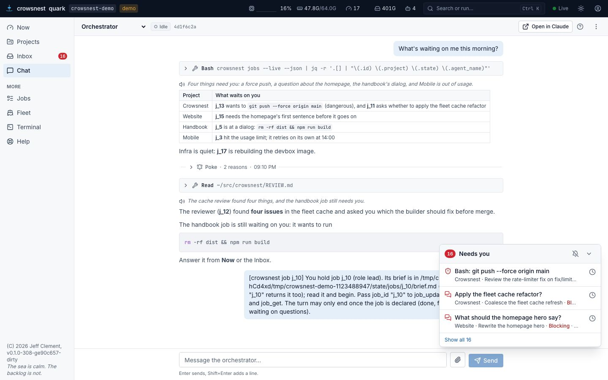

# Every view

On a phone the bottom bar is **Now**, **Projects**, **Inbox**, **Chat** and **More**; More holds
**Jobs**, **Fleet**, **Terminal**, **Help** and **System**. On a desktop the left rail shows the
same, with the More views under a heading. The account menu (top right) holds **System**,
**Settings**, **Account**, **Notifications**, **Instructions**, **Pause automation…** and **Do not
disturb…** (and **Voice** with talk mode on).

## Now

`/` · `g` then `h` · [Open Now](app:/)

Home. **Needs you** (the attention queue, answerable in place), **Projects** (one row per project,
then Unfiled and the Orchestrator), **Since you left**, and **Give a job**. See [The attention queue
and Now](../concepts/attention-and-now.md).

## Projects

`/projects` · `g` then `p` · [Open Projects](app:/projects)

The list of projects, each with its lead's state and **Start**/**Stop**, its needs-you and running
counts; **Show archived**; **New project**. A project's page (`/projects/<slug>`) has the lead's
controls, its jobs, schedules, approval rules, acceptance and budget, and instructions. See [Create
a project and tune its lead](../how-to/projects.md).

## Inbox

`/inbox` · `g` then `i` · [Open the Inbox](app:/inbox)

The attention queue in full (**Open**), **History**, and **Notices**. List and detail side by side
on a desktop; a decision packet per item on a phone. See [Answer questions and
approvals](../how-to/answer.md).

## Chat

`/chat` · `g` then `c` · [Open Chat](app:/chat)

A conversation with the orchestrator or a project's lead (**Chat with** at the top;
`/chat?target=lead-<slug>` for a lead). Replies render as formatted text with tool calls folded;
**Open in Claude** when its Remote Control link is known; the **Conversation menu** has its spend,
**Compact now**, **Poke now**, **Journal**, **Schedule**, **Instructions**, **Show thinking**,
**Restart** and **New conversation**. The composer sends with Enter on a wide screen (Shift+Enter
for a new line), takes attachments, and has the mic with talk mode on.

## Jobs

`/jobs` · `g` then `j` · [Open Jobs](app:/jobs)

The board. The project buttons filter it (All, each project, Unfiled). The job box. Spend totals,
the running count (opens **Limits**), **N to land**, **Schedule** and **Journal**. Then **Needs
you or stuck**, **In progress**, **Finished today**. A job (`/jobs?job=j_12`) has **Overview**,
**Conversation**, **Terminal** and, for a worktree job, **Review**/**Land**. See [Jobs and their
states](../concepts/jobs.md).

## Decision packet

`/decide?item=…`

One question, approval or dialog on one screen, with the answer bar at the bottom. Opened from the
tray, the Inbox on a phone, the palette and notifications. See [The decision
packet](../how-to/answer.md#the-decision-packet).

## Changes (the diff viewer)

`/diff?job=j_12` or `/diff?project=<slug>` · from a job's Review, Land or Changes tab, a project's
Changes card, the lead's **Changes** button, or the palette's **Changes: …**

A job's or project's changes, live and syntax-highlighted, with **Viewed** marks. Full screen
here: no header, nav or tray; **Back** or Esc returns. See [Review changes with the diff
viewer](../how-to/review-changes.md).

## Fleet

`/fleet` · `g` then `f` · [Open Fleet](app:/fleet)

Every herdr workspace, tab and pane, with each agent's state (working, idle, done, blocked at a
dialog), filterable with `/`. Pick an agent for its **Conversation** or **Terminal**; plain shell
panes open too. The recovery and debugging view.

## Terminal

`/terminal` · `g` then `t` · [Open the Terminal view](app:/terminal)

herdr's own TUI for the whole session. See [Use the terminal views](../how-to/terminals.md).

## Help

`/help` · `g` then `m` · [Open Help](app:/help)

This manual: the contents and a search on the left (a **Contents and search** sheet on a phone),
the page with its headings, previous and next. `/help/<page>#<heading>` links straight to a
heading. A **?** beside a view's title or a card opens a section in a side sheet instead.

## System

`/system` · [Open System](app:/system)

The doctor's report from the running server (**Re-check**, **Copy diagnostics**), versions, the
agents and which runs what, the running instance, paths, the machine, recent warnings and errors,
every check by group, settings not at their default, **Storage** (with **Download backup** and
**Clean up now…**), **Waits without an owner**, **Machines** and **Sign in with Tailscale**. See
[Doctor checks](../troubleshooting/doctor.md).

## Sheets

Opened from menus and the palette, over the current view:

| Sheet | What | From |
|---|---|---|
| **Settings** | Every setting the app may change, with its source and when it applies | Account menu; [Open Settings](app:sheet/settings) |
| **Instructions** | Global, role and project instruction layers | Account menu; [Open Instructions](app:sheet/instructions) |
| **Notifications** | This device, what to send, devices | Account menu; [Open Notifications](app:sheet/notifications) |
| **Schedule** | Scheduled tasks and the daily digest | Jobs, Chat's menu, palette; [Open Schedule](app:sheet/schedule) |
| **Spend** | Estimated spend by job, model or day | Jobs' spend button, palette; [Open Spend](app:sheet/spend) |
| **Journal** | Every poke, skip, send, answer, restart and alert | Jobs, Chat's menu, palette; [Open the Journal](app:sheet/journal) |
| **Limits** | Running jobs, load, heavy slots | Jobs' running count, palette; [Open Limits](app:sheet/limits) |
| **Worktrees still around** | Finished worktree jobs to land or discard | Jobs' **N to land**, palette; [Open it](app:sheet/worktrees) |
| **Pause automation** | Pause with an optional resume time and reason | Account menu; [Open it](app:sheet/pause) |
| **Digests** | Past daily digests | Schedule, palette; [Open Digests](app:sheet/digests) |
| **Keyboard shortcuts** | Every shortcut | `?`; [Open it](app:sheet/shortcuts) |

## The header

The instance's name and session, the **machine strip** (CPU with a one-minute sparkline, memory,
load; from wide screens free disk and working agents; on a phone one chip that opens the figures),
**Search or run…** (the command palette), the connection state, **Speak replies** (with talk
mode), the theme switch and the account menu.

<!-- STUB(wip/design): paired light and dark themes, with a picker in Settings and the palette,
are being built on wip/design. Describe the picker here (and in reference/settings if it adds a
setting) once it is on main. -->

> **Coming soon (not on main yet):** paired light and dark themes with a theme picker in Settings
> and the palette. Today the header's switch cycles System, Light and Dark, and the palette has
> **Theme: System**, **Theme: Light** and **Theme: Dark**. Banners below it: the connection, **Automation
paused**, and the fleet's usage limit.
