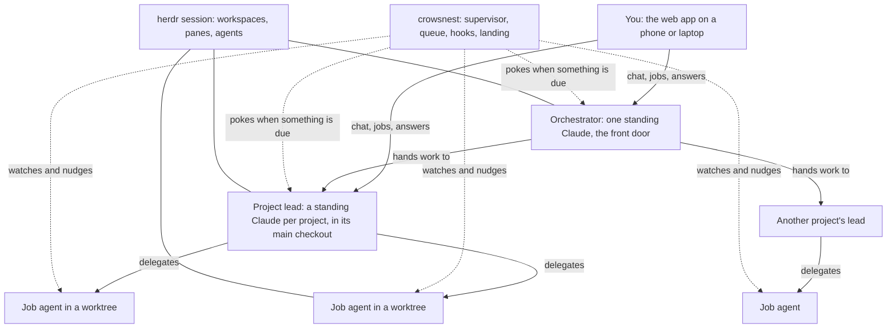
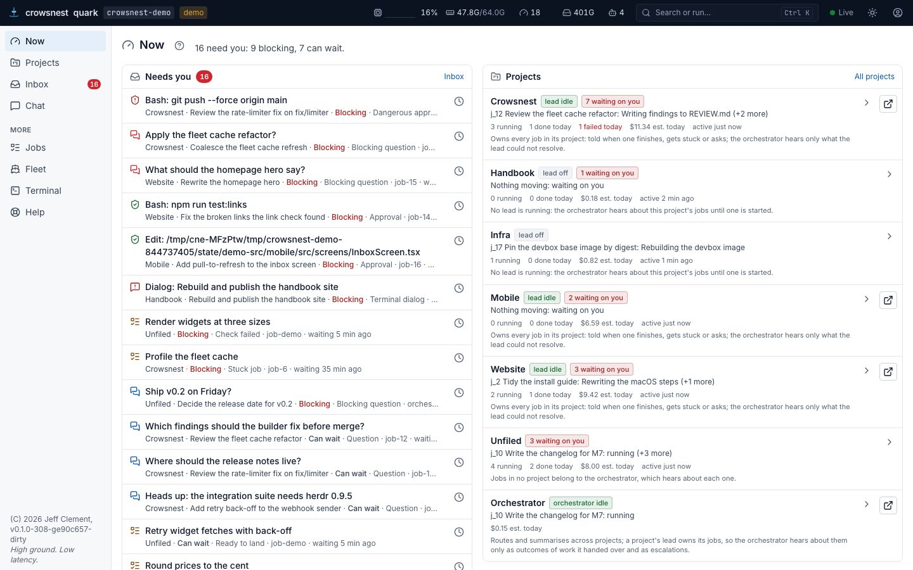

# Start here

## What crowsnest is

Crowsnest is one program that runs a herdr session for you, keeps Claude Code agents working in
it, and gives you a web app (phone or desktop) to run them from. You give it **jobs**; each job is
done by an agent in its own pane, usually in its own git worktree. A **supervisor** watches every
job, so an agent that stops without saying why is sent back to work, and one that really cannot go
on is put in front of you with the reason. Everything that needs you (a question, a permission, a
terminal dialog, a stuck job, work ready to merge) lands in one queue you can answer from your
phone. You review the result and press **Land**; crowsnest merges it and cleans up the worktree.

## The mental model

- **You** talk to the orchestrator or to a project's lead, give jobs, and answer what they ask.
- **The orchestrator** is a long-running Claude in a herdr workspace called `orchestrator`. It
  routes work across projects, holds jobs that belong to no project, and hears what the leads could
  not resolve.
- **A project lead** is a long-running Claude in a project's directory, named `lead-<slug>`. It owns
  every job in its project: it is told when one finishes, gets stuck or asks.
- **Job agents** are Claude Code (or Codex) sessions crowsnest starts for one job each, with the job
  protocol (`job_update`, `ask`, `done`, `fail`) as MCP tools and hooks that report back.
- **herdr** runs underneath. Every agent is a herdr pane you can open in the browser. herdr and its
  agents outlive crowsnest: restarting crowsnest never stops an agent.
- **crowsnest** supervises: it reads Claude's hooks and transcripts, keeps the attention queue,
  types answers back into panes, and lands finished work.

The rest of the manual expands each box: [jobs](concepts/jobs.md), [the
supervisor](concepts/supervisor.md), [projects and leads](concepts/projects-and-leads.md).

## A five-minute first session

You can try all of this without touching a real repository: `crowsnest --demo --no-auth` serves a
made-up morning across five projects, with a fake herdr and a scripted orchestrator, and throws
everything away when it exits. On a real install, run `crowsnest` and follow its setup link first
([Set up on a new machine](how-to/set-up.md)).

1. **Open Now.** It is home ([Open Now](app:/)). The top is **Needs you**: every question,
   approval, dialog and stuck job, blocking ones first. Below it, one row per project with its lead
   and what it is doing, then **Since you left**, then **Give a job**.
2. **Give a job.** In **Give a job**, choose who gets it under **For** (the orchestrator, or a
   project), type what needs doing in plain words in **What needs doing?**, and press **Give job**
   (`⌘ Enter`, `Ctrl Enter` elsewhere). A job for a project goes to its lead, which may do it
   itself or hand it to a job agent in a worktree.
3. **Watch it.** Open **Jobs** ([Open Jobs](app:/jobs)): the board lists needs-you and stuck jobs
   first, then in progress, then finished today. Each card has the job's state, its one-line
   "doing now" and how long ago it last did anything. Pick one to see its timeline, its
   conversation and its terminal.
4. **Answer something.** When an agent asks, the question appears in Needs you, in the Inbox and
   in the tray at the bottom of every view. Press it, pick an option (the agent's recommendation is
   marked), add a note if you like, and answer. The agent did not stop to wait: it carried on with
   whatever the answer does not block, and your answer is typed into its pane.
5. **Land it.** When a builder says done, crowsnest runs the project's check command itself. If it
   passes, the card reads **Accepted** and a **Land** tab appears on the job. Read the diff, then press **Merge** (or **Push and open PR**, or **Discard**). Crowsnest merges,
   removes the worktree and deletes the branch.

## Where to go next

- How work flows and why it does not stall: [Jobs](concepts/jobs.md), then [the
  supervisor](concepts/supervisor.md).
- Running many projects from a phone: [Reach it from your phone](how-to/phone.md) and [Answer
  questions and approvals](how-to/answer.md).
- Something looks stuck: [The agent stopped: what now?](troubleshooting/agent-stopped.md)
