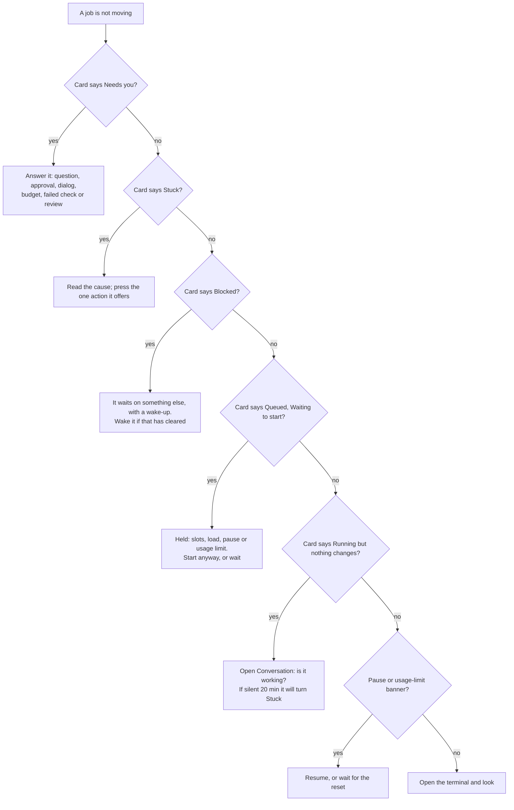

# The agent stopped: what now?

Start with the job's card. It always says something: a state, a cause, and what the agent last
said. Follow the first question whose answer is yes.

## 1. "Needs you"

Every line of work is waiting on you. The card and the Overview say which:

- **Waiting on your answers**: answer the question (Inbox, Now, or **Answer in Inbox**).
- **A tool call is waiting for your approval**: **Allow once** or **Deny**.
- **A dialog in the terminal needs you**: press the option on the card, or **Open terminal**.
- **Reached its budget**: **Raise the budget**, **Let it finish this step**, or **Stop the job**.
- **The check failed: crowsnest did not accept it**: read the end of the output; **Run the check
  again** after a fix, or message the agent.
- **The review needs you**: **Open the review**; land, discard, or send it back with a message.
- **Claude needs a login or billing fix**: **Open terminal**, run `/login`.
- **Waiting for your approval: an agent asked for it**: an agent asked for a job outside its
  directory; allow or deny it in the Inbox.

## 2. "Stuck"

A running job that is not moving. The cause tells you what happened and the Overview offers the
one action that fits. The full table is in [the supervisor](../concepts/supervisor.md#stuck-causes).
In short:

- **Stopped three times without saying why** or **Idle with nothing declared**: read **What the
  agent last said**. Usually it is unsure how to go on: send a message with the decision. Or
  **Nudge**.
- **Hit a usage or rate limit**: it retries by itself (the card shows when); **Retry now** if you
  know it reset.
- **The API returned errors**: **Retry now**.
- **The agent exited**: **Restart agent** (on the same conversation).
- **Working but silent for 20 minutes** or **Busy, but not getting anywhere**: **Open terminal**.
  If it loops, **Interrupt (Esc)** and message a different approach.

The Rescue panel has the rest (interrupt, continue, compact, switch model): [Rescue a stuck
agent](../how-to/rescue.md).

## 3. "Blocked"

The agent declared it is waiting on something that is not you, and when it will look again
("Waits on job-7: rechecks at 07:12"). If you know the block has cleared, **Wake it**. After three
rechecks of one block, you are told.

## 4. Queued, "Waiting to start"

Held. The reason is on the card: all slots taken, the machine busy, the automation paused, the
spend ceiling, or the fleet's usage limit. It starts by itself in order. **Start anyway** starts it
now. Too many held jobs often? Raise **Running jobs at once** in Settings.

## 5. Running, but nothing seems to happen

Open its **Conversation**: it may be in a long tool call (a test suite) or thinking. The heartbeat
on the card ("active 2 min ago") says when it last did anything. A job with no activity for 10
minutes whose agent is not working becomes stuck by itself; one that herdr calls working with a
quiet transcript for 20 minutes becomes **Working but silent**.

## 6. Nothing starts and nobody moves

Look under the header: **Automation paused** (press **Resume**) or the usage-limit banner with its
countdown (wait, or start a job anyway). Then **System**: is herdr connected? Is the orchestrator
running?

## Still stuck

**Open the terminal** for the job (or Fleet → the agent → **Terminal**) and look at the pane
itself: a login prompt, a crash, a draft in its input box, a dialog crowsnest did not recognise.
[Common problems](common-problems.md) lists the ones seen so far.
